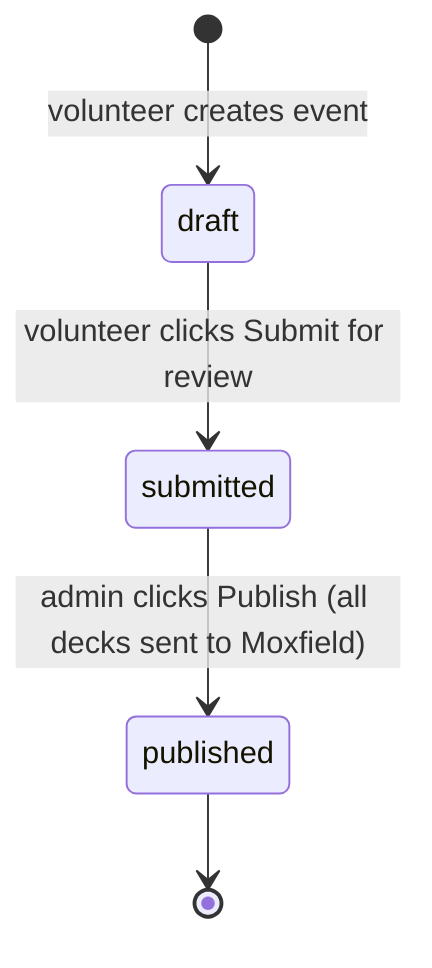
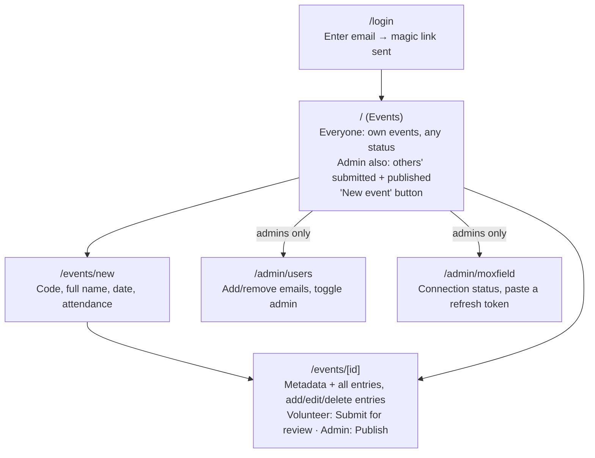

# Event Results Tool — Design

## Purpose

A small web app for an Australian 7 Point Highlander community. Volunteers enter tournament results and decklists; admins review them and publish each deck to the community's Moxfield account. It replaces the manual work currently done by one volunteer.

Keep it small. Build only what is listed here; the "Out of scope" section is deliberate.

**Moxfield is the source of truth, not this app.** This is a data entry tool: results live on Moxfield once published, and stats analysis is done separately by scraping them from there. This app's database is a staging area, so no part of the design needs to serve reporting, stats or historical queries.

## Users and roles

- **Volunteer**: a whitelisted email. Can create events, enter results, and submit their own events.
- **Admin**: a whitelisted email with `is_admin = true`. Can do everything a volunteer can, plus see and edit other people's submitted events, publish them, and manage users.
- Everyone else: cannot log in.

Authentication is by magic link. A link is only sent to emails in the whitelist. The first admin is seeded directly in the database.

## Event lifecycle



- **draft**: visible to and editable by its creator only.
- **submitted**: read-only for the volunteer. Editable only by admins, except entries already sent to Moxfield (see below).
- **published**: locked for everyone. Every entry has a Moxfield deck ID. Any later fixes are made directly in Moxfield, not in this app.

An entry with a `moxfield_deck_id` is locked, whatever the event's status: it cannot be edited or deleted individually, because the copy on Moxfield is now the real one. Deleting the whole event still removes it (see Delete event). This matters when a publish stops partway: the admin can still fix the remaining unpublished entries before retrying.

Submission is one-way. There is no feedback to volunteers.

The UI wording must make it clear that submitting does **not** send anything to Moxfield; only an admin's Publish does. Use these labels everywhere statuses or actions are shown to users (the database values stay `draft` / `submitted` / `published`):

| Status value | Shown to users as |
|---|---|
| `draft` | Draft |
| `submitted` | Submitted for review |
| `published` | Published to Moxfield |

- The volunteer's button is **Submit for review**. After submitting, the events list shows a one-line message: "Submitted for review. An admin will check it before it's published to Moxfield."
- The admin's button is **Publish to Moxfield**.

## Pages



### `/login`
- Email field. If the email is whitelisted, send a magic link. Show "check your email" either way.
- The whole login flow runs on the server (see Login flow). The whitelist check happens on the server before any email is sent.

### `/` — Events
A single table, newest first. Each row links to `/events/[id]`.

```
┌─────────────────────────────────────────────────────────────────────────┐
│ Events                                          [Users]  [+ New event]  │
├──────────────┬─────────────┬───────┬──────────────────────┬─────────────┤
│ Name         │ Date        │ Decks │ Status               │ Submitted by│
├──────────────┼─────────────┼───────┼──────────────────────┼─────────────┤
│ GGGongIQ26   │ 14 Sep 2026 │ 8     │ Submitted for review │ jo@examp…   │
│ GGGongIQ26   │ 14 Sep 2026 │ 12    │ Draft                │ (you)       │
│ MelbWeekly38 │ 13 Sep 2026 │ 16    │ Published to Moxfi…  │ sam@examp…  │
└──────────────┴─────────────┴───────┴──────────────────────┴─────────────┘
```

- Everyone sees their own events, whatever the status. Admins also see other people's submitted and published events. Nobody sees other people's drafts.
- The "Submitted by" column and the Users link are shown to admins only.
- The **Decks** column is the number of entries saved in that record. With the same event entered in several records (see Splitting an event across submissions), it's the quickest way to tell them apart.

### `/events/new`
- Fields: **event code** (required; the short code used in deck titles, e.g. `GGGongIQ26` — stored as the event's `name`), **full event name** (required; used in each deck's description, e.g. `Adventurers Guild IQ`), **date** (required), **attendance** (required, integer ≥ 1).
- Attendance is the total number of players at the event, not the number of rows to enter. Often only the top 8 are recorded.
- **Event names are not unique**, and neither is name + date. Nothing in the app checks for or warns about repeats (see Splitting an event across submissions).
- On save: create the event as `draft`, go to `/events/[id]`.

### `/events/[id]` — the event page
One page for entering, reviewing, submitting and publishing. Do not build separate entry, review or admin-edit screens.

Layout: a header, then two panes. Entries are listed on the left; the selected entry is shown and edited on the right.

**Adding a new entry.** Four entries are saved; the fifth is being typed. Submit for review is disabled while it's open.

```
┌──────────────────────────────────────────────────────────────────────┐
│ ← Events   GGGongIQ26 · 14 Sep 2026 · 32 players  Draft              │
│            [Edit details]      [Delete] (Submit for review)          │
├───────────────────────────────┬──────────────────────────────────────┤
│ ENTRIES                       │ NEW ENTRY                            │
│   01st      Anthony P  Storm  │ Placing [05th] to [08th] (optional)  │
│   02nd      Sarah K    Reani… │ Player  [Sam L                ]      │
│   03rd/04th Tom W      Oath   │ Deck    [Mono Red             ]      │
│   03rd/04th Priya R    Burn   │ Decklist                             │
│ ▸ (new entry)                 │ ┌──────────────────────────────────┐ │
│                               │ │1 Goblin Guide                    │ │
│                               │ │1 Lightning Bolt                  │ │
│                               │ │…                                 │ │
│                               │ └──────────────────────────────────┘ │
│                               │ [Cancel] [Save & close] [Save & next]│
└───────────────────────────────┴──────────────────────────────────────┘
```

**Viewing or editing an existing entry.** No new entry is open, so + Add entry and Submit for review are available.

```
┌──────────────────────────────────────────────────────────────────────┐
│ ← Events   GGGongIQ26 · 14 Sep 2026 · 32 players  Draft              │
│            [Edit details]      [Delete] [Submit for review]          │
│ ⚠ 9 entries but attendance is 8          (soft warnings, if any)     │
├───────────────────────────────┬──────────────────────────────────────┤
│ ENTRIES                       │ ENTRY                                │
│ ▸ 01st      Anthony P  Storm  │ Placing [01st] to [    ] (optional)  │
│   02nd      Sarah K    Reani… │ Player  [Anthony P            ]      │
│   03rd/04th Tom W      Oath   │ Deck    [Gluten Free Storm    ]      │
│   03rd/04th Priya R    Burn   │ Decklist                             │
│   …                           │ ┌──────────────────────────────────┐ │
│                               │ │1 Ancestral Recall                │ │
│ [+ Add entry]                 │ │…                                 │ │
│                               │ └──────────────────────────────────┘ │
│                               │ [Delete entry]      [Cancel] [Save]  │
└───────────────────────────────┴──────────────────────────────────────┘
```

Existing entries have no Save & next or Save & close; those belong only to the new-entry flow. **Save** saves the changes and keeps the entry selected. Once there are unsaved changes, Submit for review is disabled until the user clicks Save or Cancel (see Saving changes).

- **Header**: event name, date, attendance, status, and the Delete event and action buttons. When editing is allowed, an **Edit details** button makes name, date and attendance editable, with **Save** and **Cancel** (see Saving changes).
- **Left pane**: about a third of the width (fixed around 320px on desktop). The right pane takes the rest, because the decklist needs the room. Lists all entries in placing order, showing placing, player name and deck name. Clicking one selects it. **+ Add entry** opens a new entry in the right pane and shows a "(new entry)" row at the bottom of the list; the button is hidden while a new entry is open.
- **Right pane**: the selected entry's fields: **placing**, optional **placing to** for a shared range, **player name**, **deck name**, **decklist** (large textarea, pasted text), and the buttons shown in the wireframes above. When the event is read-only, the same pane shows the values as plain text (with the placing in its ordinal form, e.g. `03rd/04th`). **Deliberate deviation from the wireframes:** the two placing fields are plain number inputs (type `5`), not ordinal text fields (`[05th]`) — quicker to type and impossible to mistype; the ordinal form appears in the entries list, the read-only view and the deck title.
- The page opens with the first entry selected, or with a new blank entry open if there are none.
- Soft warning in the header if the number of entries is greater than attendance.
- **Delete event** button: shown to the creator while the event is a draft, and to admins once it is submitted or published (for duplicates or junk). Clicking it asks for confirmation with a plain browser confirm dialog.
  - If any entry has a `moxfield_deck_id` (the event was fully or partly published), the dialog says so: "Some or all of this event's decks are already on Moxfield. Deleting it here removes it from this tool only. The decks will stay on Moxfield and must be deleted there if needed."
- Action button:
  - Volunteer or admin, status `draft` → **Submit for review** (sets `submitted`, returns to `/`).
  - Admin, status `submitted` → **Publish to Moxfield** (see Publishing).
  - Submit for review and Publish are disabled while anything is being edited: a new entry is open, an existing entry has unsaved changes, or the event details are being edited.
  - Submit for review and Publish are also disabled until the event has at least one saved entry. The server enforces this too, refusing to submit or publish an event with no entries.
- When the viewer can't edit (see Permissions), the page renders read-only with no action button.
- **Publish progress**: in the entries list, each entry with a `moxfield_deck_id` shows a "published" mark (e.g. ✓) and opens read-only. After a failed publish, the admin can see at a glance which entries went through.

Keep the UI plain and functional. It does not need to be polished: no animations, no unsaved-changes warnings, no custom styling beyond what makes it clear and usable.

#### Sizing
- The page is laid out for a typical laptop screen (about 1280px wide). At that width the right pane gets roughly 900px, and a decklist needs only about 350px, so width is not the constraint.
- Space pressure is vertical: a 60-card list is long. The two panes scroll independently, so the header and the entries list stay in view, and within the entry pane the fields and buttons stay put: the decklist box fills the remaining height and **scrolls inside itself** when the list is longer (it doesn't grow to fit its content, and the pane doesn't scroll).
- In the entries list, long player or deck names are truncated with an ellipsis rather than wrapping.
- If it feels cramped once real data is in it, the first fix is to put player name and deck name side by side above the decklist. Don't build this up front.

#### Fast entry flow
Entering a whole event should be a loop with no extra clicks: type the player, deck, paste the list, go straight to the next one.

- A new entry's fields are ordered for tabbing: player name → deck name → decklist → **Save & next**. Placing is pre-filled with the suggested next placing (see Placings) and sits above the other fields, so it is only touched when it needs overriding.
- A new entry has three buttons:
  - **Save & next** (also **Ctrl/Cmd+Enter** from any field): saves the entry, adds it to the list, and immediately opens a fresh entry with the next suggested placing and the cursor in player name.
  - **Save & close**: saves the entry, adds it to the list, and returns to the event with no entry open. Use it when the event is finished, or to take a break. **+ Add entry** is still there to carry on.
  - **Cancel**: discards the entry and returns to the event with no entry open.
- Both save buttons are disabled until player name, deck name and decklist are filled.
- **A new entry is saved only when a save button is pressed.** Nothing else saves it: not Submit for review, not ← Events, not closing the tab. Leaving any other way discards it, with no warning.
- **Submit for review is disabled the whole time a new entry is open.** To submit, the volunteer first uses Save & close (or Cancel). This keeps "finishing an entry" and "submitting the event" as clearly separate steps.
- Saving each entry as it's finished is what makes drafts work; there is no "save draft" feature.

#### Saving changes
The same rule applies everywhere on this page, for volunteers editing their drafts and admins editing submitted events alike: **nothing is saved unless a Save button is clicked.**

- **Existing entry**: selecting it shows its fields, editable when allowed. **Save** writes the changes. **Cancel** reverts them. **Delete entry** removes it.
- **Event details** (name, date, attendance): changed via **Edit details**, then **Save** or **Cancel**.
- While any edit is in progress (a new entry is open, an existing entry has unsaved changes, or the event details are being edited), the other entries in the list are not clickable. The user must Save or Cancel first. This stops an edit being lost just by clicking the next entry. Use the same "edit in progress" flag that disables Submit for review and Publish.
- Unsaved changes are discarded, without warning, only when the user clicks ← Events or leaves the page.
- Submit for review and Publish stay disabled while any edit is in progress, so an event is never submitted or published with changes still pending.

### `/admin/users`
- Admins only.
- Lists whitelisted emails with admin status.
- Add an email (optionally as admin), remove an email, toggle admin.

### `/admin/moxfield`
- Admins only.
- Shows the Moxfield connection status (connected, or needs reconnecting), who last set it and when.
- A form to paste a new refresh token. Saving validates it immediately (calls Moxfield to confirm it works) before storing it, so a bad paste is caught on the spot. See Moxfield connection (admin) for the full mechanism.

## Splitting an event across submissions

A real tournament can be entered as several separate event records, so volunteers can share the work or enter it in chunks over time. Each record holds part of the results: one person might enter the top 8 and another the rest.

- Each record is created, submitted and published on its own. Nothing links them together, and nothing needs to.
- They carry the same event name, so the decks published from them all get matching titles on Moxfield (see Deck title format). This is why names are not unique.
- **Placings are the volunteer's responsibility.** The suggested next placing (see Placings) only looks at entries in the same record, so someone entering the 9th–16th chunk starts with a suggestion of `01st` and overrides it. That's expected.
- **Attendance is the whole tournament's attendance** in every record, not that chunk's share. It describes the tournament, so it's repeated rather than divided.
- The "entries exceed attendance" warning applies per record, which is still useful and can't false-alarm from splitting.

The events list shows name, date, status and submitter, which is enough to tell records apart. There is no merging, linking or duplicate warning; if a volunteer starts a record by mistake, they delete their draft.

## Placings

A placing is either a single position or a **shared range**, where several players finished in the same band and their order within it was never decided.

Common cases:
- **Single-elimination top 8.** Quarterfinal losers are not played off, so all four are `05th/08th`. Semifinal losers are usually `03rd/04th`. The finalists are `01st` and `02nd`.
- **Split.** Players agree to split prizes instead of playing on. For example, a top 4 split puts all four at `01st/04th`.
- **Swiss-only placings** (outside a top cut) are usually single positions: `09th`, `10th` and so on.

Rules:
- `placing_from` is always set. `placing_to` is set only for a shared range.
- Everyone in the same range has the same `placing_from` and `placing_to`.
- Entries sort by `placing_from`, then by entry order.

### Suggested next placing

The add-entry form pre-fills the placing so the common single-elimination top 8 needs no typing:

`01st`, `02nd`, `03rd/04th` ×2, `05th/08th` ×4, then `09th`, `10th`, …

Rule, based on the entry with the highest `placing_from` so far (the "last range"):
1. No entries yet → `01st`.
2. If the last range is shared and has fewer entries than its size (`placing_to − placing_from + 1`) → suggest the same range again. "Entries in the last range" means entries with exactly the same `placing_from` and `placing_to`.
3. Otherwise the next position is one past the end of the last range. Suggest `03rd/04th` if that position is 3, `05th/08th` if it is 5, otherwise a single placing.

Overrides flow on naturally. If a volunteer changes the first entry to `01st/04th` (a top 4 split), rule 2 fills the next three at `01st/04th` too. A top 16 cut works the same way: set `09th/16th` once and the rest follow.

## Permissions

Enforce these in the server/API routes, not just by hiding buttons.

- The events list endpoint returns only the events that user should see (see `/`), so clients aren't sent everyone's drafts. This is for tidiness, not security, so fetching a single event by ID doesn't need a visibility check.
- A user can edit an event and its entries if (status is `draft` AND they created it) OR (they are an admin AND status is `submitted`).
- An entry with a `moxfield_deck_id` can never be edited or deleted individually, whatever the rule above says. Deleting the whole event still removes it (see Delete event).
- A user can delete an event if (status is `draft` AND they created it) OR (they are an admin AND status is not `draft`).
- Only admins can publish, see other people's submitted and published events, or use `/admin/users` or `/admin/moxfield`.
- Publishing an entry and publish-complete both require the event to be `submitted`. The server checks this on every request, so an admin can't publish a draft by calling the API directly.
- Moxfield credentials and other secrets are server-side only (see Secrets).
- All database reads and writes happen on the server, over a normal Postgres connection. The connection string is a server-side environment variable and is never sent to the browser. The database has no public API (leave Neon's optional Data API switched off), so there is no other route to the tables.
- On every request, the server gets the logged-in email from the Better Auth session and looks it up in `allowed_users`. If the email is no longer there, the request is refused. This way, removing someone from the whitelist takes effect immediately, even if they're still logged in.
- The login page only sends a magic link after checking on the server that the email is in `allowed_users`.

## Login flow

Login uses [Better Auth](https://www.better-auth.com) with its magic link plugin, running inside this Next.js app. Users, sessions and magic-link tokens are stored in the app's own Postgres database; there is no separate auth service. The browser uses no Better Auth client code: it just submits forms.

- Only the magic link plugin is enabled. No email/password, no social logins.
- Better Auth's routes are mounted at `/api/auth/[...all]`, which anyone can call. So the whitelist check lives **inside the `sendMagicLink` callback**, not only in the login form. Even someone calling Better Auth's endpoint directly can't send emails from the Gmail account to arbitrary addresses or create junk users.
- Add Better Auth's `nextCookies()` plugin, so server actions can set and clear the session cookie.
- Set the magic link's `expiresIn` to 15 minutes. The default of 5 minutes is short when an email arrives late.

1. **Request a link**: the login form posts the email to a server action, which normalises it and calls `auth.api.signInMagicLink`. Better Auth then calls `sendMagicLink({ email, url })`. That function checks `allowed_users`. If the email is listed, it sends `url` in a plain-text email (see Stack); otherwise it does nothing. Either way, the page shows "check your email".
2. **Email link**: `url` points at Better Auth's verify route in this app (`/api/auth/magic-link/verify?token=…&callbackURL=/`). The email's wording is written in the app's code, so there's no template to set up anywhere else.
3. **Confirm**: Better Auth checks the token (single use), creates the user record on their first login, sets the session cookie and redirects to `/`. This works even if the link is opened in a different browser or device from the one that requested it.
4. **Each request**: the server gets the logged-in user with `auth.api.getSession({ headers })`, then applies the `allowed_users` check (see Permissions).
5. **Log out**: a small log-out button in the header. It is a form that POSTs to a server action calling `auth.api.signOut`. It must not be a link or a GET route: Next.js prefetches link targets, which would log people out just by showing the header.

## Secrets

Secrets are the database connection string, the Better Auth secret (`BETTER_AUTH_SECRET`, which signs session cookies), the Gmail app password, and `MOXFIELD_TOKEN_ENCRYPTION_KEY` (encrypts the Moxfield tokens and User-Agent at rest — see Moxfield connection). Moxfield's whitelisted User-Agent and the refresh token are **not** environment variables — they're admin-managed, encrypted, database-stored state (see Moxfield connection).

- **Never in git.** Local secrets live in `.env.local`, which is listed in `.gitignore` from the very first commit. Commit a `.env.example` that lists every variable name with empty values, so it's clear what needs setting.
- **In production**, secrets are set in Vercel's project settings under Environment Variables, marked as Sensitive.
- **Nothing uses the `NEXT_PUBLIC_` prefix.** In Next.js, that prefix copies the value into the code sent to the browser. This app needs no browser-side configuration at all, because login runs on the server.
- The Moxfield, database, auth and email modules start with `import "server-only"`, so the build fails if any of them is ever imported into browser code by mistake.
- Never log secrets. Error messages from the Moxfield module must not include request headers, tokens or credentials.
- If a secret leaks, rotate it: generate a new one, update it in Vercel, and redeploy. If the Moxfield refresh token leaks, an admin reconnects via `/admin/moxfield` with a fresh one — no Vercel access needed (see Moxfield connection).

## Data model

```
allowed_users
  email        text, primary key
  is_admin     boolean, default false

events
  id           uuid, primary key
  name         text, required -- the short event code used in each deck's title, e.g. GGGongIQ26
  full_name    text, required -- the full event name written in each deck's description, e.g. Adventurers Guild IQ
  date         date, required
  attendance   integer, required
  status       text, required, default 'draft'
  created_by   text, required -- creator's email; plain text so removing a user keeps their events
  created_at   timestamptz, default now()

entries
  id                 uuid, primary key
  event_id           uuid → events.id (cascade delete)
  placing_from       integer, required
  placing_to         integer, nullable    -- set only for a shared range
  player_name        text, required
  deck_name          text, required
  decklist_raw       text, required       -- stored exactly as pasted
  moxfield_deck_id   text, nullable       -- set when published
  publish_claimed_at timestamptz, nullable -- set while a publish request is working on this entry (see Publishing)
  moxfield_pending_deck_id text, nullable -- deck created on Moxfield but not yet filled with cards (see Writing the deck); does NOT lock the entry
  created_at         timestamptz, default now() -- entry order within a shared range

moxfield_connection
  id                       integer, primary key, always 1 -- singleton: exactly one row
  encrypted_refresh_token  text, nullable -- AES-256-GCM; see Moxfield connection (admin)
  encrypted_access_token   text, nullable
  access_token_expires_at  timestamptz, nullable
  moxfield_username        text, nullable -- the Moxfield account the token belongs to (from the token response's user_name)
  encrypted_user_agent     text, nullable -- AES-256-GCM; the User-Agent Moxfield issued
  user_agent_updated_by    text, nullable -- admin's email (lowercase); independent of updated_by, which belongs to the token
  user_agent_updated_at    timestamptz, nullable
  updated_by               text, required -- admin's email
  updated_at               timestamptz, required, default now()
```

Better Auth also needs its own tables (`user`, `session`, `account`, `verification`). Generate their SQL once with Better Auth's CLI (`npx @better-auth/cli generate`) and save it as one of the schema `.sql` files. Better Auth manages these tables; the app's own code never queries them.

- `allowed_users` stays separate from Better Auth's `user` table. `allowed_users` is the whitelist; `user` only records who has logged in.
- Nothing in the app's tables references Better Auth's IDs. `created_by` is the email, so the auth tables can be replaced without touching events or entries.

All timestamps use `timestamptz`, never plain `timestamp`.

**Rules enforced in the schema.** The "must" rules are also `CHECK` constraints, so a bug in any code path can't store bad data:

```sql
-- events
CHECK (status IN ('draft', 'submitted', 'published'))
CHECK (attendance >= 1)
CHECK (created_by = lower(created_by))

-- entries
CHECK (placing_from >= 1)
CHECK (placing_to > placing_from)   -- passes when placing_to is NULL

-- allowed_users
CHECK (email = lower(email))

-- moxfield_connection
CHECK (id = 1)
CHECK (updated_by = lower(updated_by))
```

Store the decklist exactly as pasted. No parsing is needed for the MVP.

**Emails are always lowercased and trimmed** before being stored or compared: in `allowed_users.email`, `events.created_by`, the login form, and the email read from the Better Auth session. Otherwise `Jo@example.com` could be locked out, or `created_by` could stop matching the logged-in user. Do this in one small `normaliseEmail()` function used everywhere. Both email columns also have a database check (see above) so a mixed-case value can never be stored by mistake.

## Publishing to Moxfield

The Moxfield integration lives in one module (e.g. `lib/moxfield.ts`) exposing one function. It must stay isolated, so that if Moxfield's API changes, only this module needs fixing.

```
publishDeck({ title, decklist }) -> moxfieldDeckId
```

- The module knows only about Moxfield: auth, endpoints, request format and parsing responses. It knows nothing about events, entries, placings or the database, beyond the connection state described below.
- The app knows nothing about Moxfield beyond that. It builds the title (see Deck title format) and passes `decklist_raw` unchanged, then stores the returned ID. The decklist is sent exactly as the volunteer pasted it, with no checking or reformatting. Decklist validation is one of the first planned additions (see Later).
- The module throws on any failure, with a readable message that the event page can show.
- The module paces its own requests: it waits a configurable delay before each call to Moxfield (`MOXFIELD_DELAY_MS`, default `1000` — one second, the cautious choice given the limit below), so publishing a whole event never sends a burst of requests. The pacing lives here, not in the publish loop, because it's a Moxfield concern.
- **The one-request-per-second limit applies only to calls made with the User-Agent alone, and the account-authenticated (Bearer token) calls are explicitly excluded from it.** The limit comes from the email Moxfield's community manager sent with the User-Agent ("no greater than one (1) request per second ... possibly getting banned by the firewall"), which is a condition of that credential; Moxfield hasn't said it covers the authenticated calls, and the project owner has decided it doesn't. So token refresh, create-deck and bulk-edit are strictly outside it, and are paced only by `MOXFIELD_DELAY_MS` — which defaults to a full second anyway, so in practice everything stays within the limit. Any User-Agent-only call (for example a read) must be limited to one per second. Residual risk: Cloudflare returned a 429 (error 1015) on one authenticated call during testing, which is why a 429 stops the run with a clear error (below) and Publish resumes from where it stopped.
- If Moxfield responds that it's rate limiting (HTTP 429), the module throws a clear error and does not retry automatically. The admin can click Publish again to resume.
- For testing the retry-UI path without touching the real Moxfield connection, set `MOXFIELD_SIMULATE_FAILURE` (any non-empty value, non-production only) to make the module throw before calling Moxfield at all.

**Status of the Moxfield API:** the project owner has investigated and verified the Moxfield API directly (see `scripts/moxfield_probe.py` and its findings). This confirmed both that it supports everything this app needs — creating decks and writing cards to them on the community account — and the exact authentication mechanism (below). Treat publishing as a solved, already-verified problem: do not re-research Moxfield's API or design around the possibility that it won't work.

### Moxfield connection (admin)

Publishing needs two credentials, both scoped to the community Moxfield account:

- **A whitelisted `User-Agent` string**, issued by Moxfield support. Gets requests through Moxfield's Cloudflare firewall. It is tied to the Moxfield account, so the production account has a different one from a test account — which is why it is **admin-managed and stored encrypted in the database** (set under Moxfield Settings), not an environment variable. It can't be validated when saved (there's no safe User-Agent-only call to test it with); a wrong one shows up as the firewall blocking the next request.
- **A refresh token**, obtained by an admin logging into moxfield.com in their own browser and copying it from DevTools (Network tab → the `startup/authenticated` request → Response tab → the `refresh_token` field inside the `refresh` object). This is what actually grants write access — Moxfield treats it as the account's password. It's exchanged for short-lived access tokens as needed, and **is only ever entered through this app's admin UI, never as an environment variable.**

Any admin can supply or replace the refresh token, because any admin already has the community account's own login credentials — this isn't a secret only the project owner can rotate.

**Storage.** The refresh token, and the short-lived access token derived from it, are stored **encrypted** in the `moxfield_connection` table (see Data model), never in plain text. A database leak alone must not be enough to get write access to the community's Moxfield account.

- Encryption is AES-256-GCM, via Node's built-in `crypto` module — no new dependency.
- The encryption key is a separate secret, `MOXFIELD_TOKEN_ENCRYPTION_KEY`, held only as a server environment variable, never in the database. Compromising the database alone yields only ciphertext.
- `lib/moxfieldAuth.ts` (server-only) owns encryption, storage and refreshing. Nothing else touches the `moxfield_connection` table directly.

**Admin page — `/admin/moxfield`.** Admin-only (same check as `/admin/users`). Has two forms: the **User-Agent** (set first; never shown again after saving) and the **refresh token**. Shows the connection status (connected / needs reconnecting, **which Moxfield account it's connected to**, and who last set it and when — the account name comes from `refresh.user_name` in Moxfield's token response and is refreshed on every token refresh) and a form to paste a new refresh token. Saving **validates the token immediately** (calls Moxfield to confirm it works) before storing it, so a bad paste is caught on the spot rather than during a real publish run.

**Getting a usable access token.** `lib/moxfieldAuth.ts` exposes `getValidAccessToken()`:
1. If the stored access token has more than a minute of validity left (access tokens last roughly 15 minutes), decrypt and return it — no Moxfield call needed.
2. Otherwise, decrypt the stored refresh token and call Moxfield's refresh endpoint. Save the new refresh token (Moxfield may rotate it on each use) and the new access token with its expiry, encrypted, and return the access token.
3. If Moxfield answers the refresh call with HTTP 400 (`{"":["Invalid refresh token."]}`, verified), the refresh token is dead. Throw a distinct, recognisable error (e.g. `MoxfieldReauthRequiredError`) rather than a generic failure, so callers can tell the two apart. Any other failure (a 429, a 5xx, a network error) says nothing about the token, so it is a plain, retryable error — never a reason to ask an admin to reconnect.

Access tokens are JWTs that last 900 seconds; read the expiry from the token's `exp` claim rather than assuming. Because Moxfield rotates the refresh token on every use (verified), two requests refreshing at the same moment would race — the second would present an already-replaced token and look "dead". So refreshing happens inside a database transaction holding an advisory lock, and re-reads the row after taking the lock: if another request just refreshed, it uses that result instead of refreshing again.

`publishDeck` calls `getValidAccessToken()` before each Moxfield request. Because most entries in a publish run happen inside the same ~15-minute window, only occasional calls actually hit Moxfield's refresh endpoint — most reuse the cached access token.

**When the refresh token has died:** the reauth-specific error surfaces through the same per-entry error handling the publish loop already has (see Publish flow below) — the browser stops and shows a message telling the admin to reconnect Moxfield at `/admin/moxfield`, instead of a generic "publish failed". The event keeps its current status and nothing new is marked as published, exactly as for any other publish failure; entries already published keep their IDs, so publishing again after reconnecting resumes normally.

**No environment-based stub switching.** Development, Preview and Production all run the same real `lib/moxfield.ts` — there's no `VERCEL_ENV`-based branching and no fake IDs. Isolation between environments comes from the existing separation of development and production databases (see Stack): each has its own `moxfield_connection` row, so Development/Preview testing publishes to whatever Moxfield account an admin has connected in the *development* database (in practice, a personal test account, not the community's) — never the production one, because Preview never touches the production database. This mirrors exactly how event and entry data already stay isolated between environments.

**Which account decks go to:** there is no setting — it is whichever Moxfield account the pasted token belongs to. To stop an admin publishing to the wrong one unknowingly, the account name is shown on `/admin/moxfield` and beside the Publish button on the event page (read from the database, so no Moxfield call is made when the page loads).

### Writing the deck to Moxfield

Verified directly against the real API (on a test account) — this is what `publishDeck` does, and why:

1. **Create** — `POST /v3/decks` with `{ name: <title>, format: "highlanderAustralian", visibility: "public", description: <description> }` (see Deck description below). `highlanderAustralian` is Moxfield's ID for this format (`highlander` and `australianHighlander` are rejected). Decks are public because the results are analysed by scraping Moxfield. Returns `{ isSuccessful, errors, publicId }`; the `publicId` is the ID we store.
2. **Fill** — `PUT /v3/decks/{publicId}/bulk-edit` with `decklist_raw` as the `mainboard` text and every other board `""`. This is only safe because the deck is brand new: **an empty string clears a board** (verified), and the request replaces the whole deck, so it must never be sent to a deck that has content in a board we blank.
3. **Send names only.** Plain lines (`1 Lightning Bolt`) work, as do `1x` quantities, split cards (`1 Fire // Ice`) and stray whitespace. Heading lines (`Deck`, `Sideboard`) and blank lines are silently ignored — which also means a pasted sideboard is merged into the mainboard, not kept separate. Adding a set code that doesn't match the card (`(LEA)` on a card that isn't in that set) makes the line fail, so we don't add any.
4. **Failure is a 200.** Moxfield answers HTTP 200 even when cards weren't found. Check `isSuccessful`; on `false`, `errors.boards.mainboard` is a list of `{ lineNumber, errorMessage, originalText }` (line numbers count lines of the text exactly as pasted). **A failed bulk-edit changes nothing** — the deck is left exactly as it was (verified with a misspelled card, a wrong set code and an all-unknown list) — so it is safe to retry into the same deck. Show the admin the offending lines ("Line 3: Could not find card 'Lightnin Bolt'") so the decklist can be fixed on the entry.
5. **Pending deck.** As soon as step 1 succeeds, save the new `publicId` on the entry as `moxfield_pending_deck_id`. If step 2 then fails, the entry stays unpublished and unlocked (the admin can fix the decklist), and the next attempt skips step 1 and writes into that same deck — so a fixable typo never leaves a trail of empty public decks on the account. Only when step 2 succeeds is `moxfield_deck_id` set (locking the entry) and the pending ID cleared. There is no delete-deck endpoint, so an abandoned pending deck (for example the entry was deleted) has to be removed by hand on moxfield.com.
6. **The title must be 2–100 characters** (Moxfield rejects anything else, on create and rename). The title format below can exceed that, so the app checks the finished title when an entry is saved and when event details are saved, and refuses with a message saying how many characters over it is — rather than truncating, so what's on Moxfield always matches what was entered.

**Deck description.** Every published deck carries a description built from its event: `{date as DD/MM/YY}, {full event name}, {attendance} players` — for example `27/09/26, Adventurers Guild IQ, 22 players` (`1 player` for an attendance of one). The full event name is the event's `full_name` — distinct from the short event code (`name`) used in the deck title. Verified against the real API: the create call accepts `description`, stores it exactly as sent, and it survives the decklist write, so it costs no extra request. The description is written when the deck is created, so a retry into a pending deck keeps the one it was created with; changing an event's date, name or attendance afterwards does not update decks that are already on Moxfield.

**For whoever analyses the results (separate from this app):** Moxfield's deck search hides decks it considers illegal in the format unless `showIllegal=true` is passed. A published result can be flagged illegal (a wrong count, a points-cap breach), so a scraper that omits that parameter will silently miss some of them.

Publish flow for an event. The admin's browser drives the loop, one entry per server request, so no single request runs long enough to hit Vercel's time limit:

1. The browser works through the entries in placing order, **one at a time**, **skipping any that already have a `moxfield_deck_id`**. Never publish entries in parallel: requests must stay sequential to respect Moxfield's rate limit.
2. For each one, it calls a server route, e.g. `POST /api/entries/[id]/publish`. The server checks the admin permission, builds the title, calls `publishDeck` (which applies the Moxfield delay), saves the returned ID on that entry, and returns it. If the entry already has an ID, the server returns it without calling Moxfield again.
3. The browser marks that entry ✓ in the entries list straight away, and the header shows a simple count ("Publishing 37 of 200…"), so progress is visible on a long run. Moxfield can be slow to respond, so a large event may take a while and the admin needs to keep the tab open.
4. If any request fails, the browser stops and shows the error. The event keeps its current status.
5. After the last entry, the browser calls a server route to finish, e.g. `POST /api/events/[id]/publish-complete`. The server checks that every entry has a `moxfield_deck_id`, then sets status `published`. It refuses if any entry is missing an ID.

The browser never talks to Moxfield directly. Moxfield credentials stay on the server.

#### Preventing double publishing
A double-click, a second tab or two admins at once could start two publish loops on the same event. Both could see "no ID" for an entry and both call Moxfield, creating a duplicate deck.

- **In the browser:** the Publish to Moxfield button is disabled from the moment it's clicked until the run finishes or stops with an error. This covers double-clicks.
- **On the server:** before calling Moxfield, the per-entry route claims the entry in a single SQL statement:

  ```sql
  UPDATE entries
  SET publish_claimed_at = now()
  WHERE id = $1
    AND moxfield_deck_id IS NULL
    AND (publish_claimed_at IS NULL OR publish_claimed_at < now() - interval '10 minutes')
  RETURNING id;
  ```

  If no row comes back and the entry already has a `moxfield_deck_id`, the route returns that ID as normal. Otherwise another request has the entry, and the route returns an error, "This entry is already being published", without calling Moxfield. The browser stops its loop and shows that message. This covers second tabs and two admins, because the database only lets one request win.
- On success, the route saves `moxfield_deck_id`, clears `moxfield_pending_deck_id`, and clears `publish_claimed_at`. On failure, it clears `publish_claimed_at` so a retry can claim it straight away, and keeps any `moxfield_pending_deck_id` so the retry writes into the same deck (see Writing the deck).
- The 10-minute expiry covers a request that dies without cleaning up (e.g. a timeout). It is safe only because it is longer than the route's `maxDuration` of 5 minutes (below). If `maxDuration` is ever raised, raise the expiry to match.

Set the per-entry publish route's `maxDuration` to a fixed `300` (5 minutes), so one slow Moxfield response doesn't time out the request. The 10-minute claim expiry above depends on this value.

If the admin closes the tab or loses connection partway, publishing just stops. Clicking Publish again resumes from the first entry without an ID, so entries already saved with an ID are never published twice.

**Known limitation:** if Moxfield creates a deck but the request fails before the ID is saved (a timeout or dropped connection), the app can't know the deck exists, and a retry creates a second one. Nothing on the app's side can fully prevent this. When a publish fails with a timeout or network error, the error message on the event page should say: "Check Moxfield for a duplicate of this deck before retrying."

### Deck title format

```
{placing} {player_name} - {deck_name} - {event_name}
```

- Each placing number is a zero-padded ordinal: `01st`, `02nd`, `03rd`, `04th`, `11th`, `22nd`.
- A shared range shows both ends, joined by `/`: `01st/04th`, `05th/08th`.
- A single placing shows just that position: `01st Anthony P - Gluten Free Storm - GGGongIQ26`.
- A shared range example: `01st/04th Anthony P - Gluten Free Storm - GGGongIQ26`.
- `{event_name}` is the event name exactly as entered (e.g. `GGGongIQ26`). There is no separate short code.

## Code style

The owner is not a JavaScript developer and will maintain this code. Optimise for reading and changing the code, not for performance or cleverness.

- Prefer simple, explicit, even verbose code over concise or clever code. A minor performance cost is fine.
- Spell things out: descriptive variable and function names, early returns and plain `if` statements rather than nested ternaries or chained one-liners.
- Comment the *why* wherever a rule isn't obvious from the code, e.g. permission checks, the placing suggestion, and publish idempotency.
- Keep business rules (permissions, placing suggestion, title format) as small plain functions in one clearly named place each, so they can be found and changed without reading UI code.
- TypeScript throughout, with `strict` mode on, so mistakes are caught before they run. Keep the types simple: plain named types for rows like `Event` and `Entry`, no advanced generics or type tricks, and no `any`.
- Keep dependencies to a minimum. No state management library, no ORM or query builder, and no UI component library unless it clearly removes a lot of code.
- Database access is plain, hand-written SQL through the `pg` library, using one shared connection pool that Better Auth also uses. The owner is comfortable with SQL, so queries should read as ordinary SQL.
- Always pass values to queries as parameters, never by building SQL strings from user input.
- The schema lives in the repo as plain `.sql` files, run in order, with no migration framework.
- Avoid framework magic where a plain alternative exists. Each page and API route should be readable top to bottom.
- Include a short README covering how to run it locally, the environment variables, and how to seed the first admin.

## Testing

Automated tests cover only the pure business rules: functions that take values and return an answer, with no database, network or UI. These are the fiddly parts most likely to break quietly when edited, and each test doubles as a readable example of how the rule should behave.

- **Placing suggestion**: the standard top 8 sequence (`01st`, `02nd`, `03rd/04th` ×2, `05th/08th` ×4, `09th`); an overridden `01st/04th` split filling the next three; a `09th/16th` range filling; the first entry of an empty event.
- **Title format**: zero-padded ordinals including `11th`, `12th`, `13th`, `21st`, `22nd`; single placings; shared ranges; the example `01st/04th Anthony P - Gluten Free Storm - GGGongIQ26`; and the 100-character title limit (exactly 100 accepted, 101 refused, with the message naming how far over it is).
- **Email normalising**: mixed case and surrounding spaces, e.g. `  Jo@Example.com ` becomes `jo@example.com`.
- **Permissions**: an event with no entries cannot be submitted or published; an entry in a `draft` or `published` event cannot be published, even by an admin; each edit, delete and publish rule for a creator, another volunteer and an admin, across each status; entries with a `moxfield_deck_id` always locked.

Use Vitest. Tests run with one command (`npm test`). Write each test so it reads as a plain example: a descriptive name, the input, the expected output.

Do not write tests for pages, database access or the Moxfield module. Check those by using the app.

## Stack (proposed)

- Next.js on Vercel (existing hosting and domain). Set the Vercel function region to Sydney (`syd1`), so the server sits next to the database.
- Neon for the hosted Postgres database, created in the AWS Asia Pacific (Sydney) region. On the free plan the database sleeps after 5 minutes idle and wakes on the next query, usually in under a second. The app never needs a manual restart, however long it goes unused. Use Neon's pooled connection string (the host with `-pooler` in its name), because Vercel functions open many short-lived connections.
- Better Auth for magic-link login (see Login flow). It uses the same database and connection pool as the rest of the app.
- Better Auth needs its base URL to build magic links. Set `BETTER_AUTH_URL` for local development and Production. Preview deployments get a new URL each time, so there the auth config falls back to `https://${process.env.VERCEL_URL}`.
- Two Neon projects: one for development, one for production. Use separate projects rather than Neon branches, so each gets its own free compute allowance and nothing is copied from production.
  - Local development and Vercel Preview deployments use the development project. Only the Vercel Production environment uses the production project. Each environment's variables point at the right project.
  - Test data therefore never reaches production, and no wipe is needed before going live. This also isolates Moxfield publishing (see Moxfield connection): each database has its own `moxfield_connection` row, so development/Preview testing can only ever publish to whatever (test) Moxfield account an admin has connected in the development database.
  - Both projects need the same setup: schema `.sql` files run (including Better Auth's) and a first admin seeded. The README should list these steps once, to follow for each project.
- Gmail SMTP for sending magic links, via Nodemailer: a dedicated Gmail account with an app password. Sending lives in one small module (e.g. `lib/email.ts`) exposing one function, `sendEmail({ to, subject, text })`, so the provider can be swapped later by changing only that file. The README should explain how to create the app password.

## Out of scope for MVP

- Decklist validation.
- Player name autocomplete.
- Feedback or notifications to volunteers.
- Duplicate-event detection.
- Public results pages or stats.
- Mobile or narrow-screen layouts. The app is desktop-only.

## Later (not now)

- **Soft decklist warnings**: total card count, singleton violations (basics excepted), points total against the current points list (stored as editable data, not code), unrecognised card names (Scryfall bulk data).
- **Player name autocomplete** from names already in `entries`, if admins end up correcting names often.
- **6-digit login code** alongside the magic link, if email scanners start using up links before volunteers click them.

